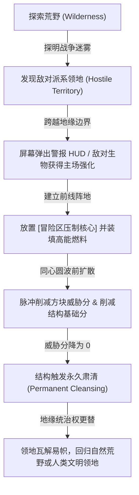

# Civil Adventure (文礼·地缘对抗生态引擎)

[](https://minecraft.net/)
[](https://files.minecraftforge.net/)
[](https://www.oracle.com/java/)
[](https://github.com/rumengfangxing/civil_adventure/releases)
[](https://www.curseforge.com/minecraft/mc-mods/civillis)

> **Civil Adventure** 是一款针对 Minecraft 1.20.1 Forge 平台深度开发的高性能**多派系地缘对抗与宏观领地割据引擎**。  
> 本模组全面重构并升格了前置模组 **Civillis (文礼)** 的单向静态冒险区（Zone）逻辑，为整合包作者提供了一套完全数据驱动、支持多方异族割据、成王败寇宏观领地聚类、同心圆波前削减压制以及 OpenGL CoreShader 战术战争迷雾的领地争端解决方案。

---

## 📖 官方文档与配置 Wiki / Documentation & Wiki

本模组提供详尽的中英文双语深度配置与数据包开发手册：

- 🧭 **[Wiki 导航总览 / Wiki Index](./wiki/README.md)**
- 🇨🇳 **[中文版深度配置手册 (CONFIGURATION_GUIDE_ZH.md)](./wiki/CONFIGURATION_GUIDE_ZH.md)**
- 🇬🇧 **[English In-Depth Configuration Guide (CONFIGURATION_GUIDE_EN.md)](./wiki/CONFIGURATION_GUIDE_EN.md)**

---

## 🌟 核心特性与架构亮点

### 1. 🌐 多派系地缘割据与成王败寇 (Multi-Faction Geopolitics)
- **平等共存与对抗**：原生支持人类文明、灾厄、真菌感染（Spore）、血肉重铸（Biomancy）及任意由数据包添加的自定义派系。
- **8-连通域泛洪聚类 (8-Connected Flood-Fill BFS)**：相邻的危险方块与结构自动融合成统一的宏观连通领地；系统在聚类内动态统计各派系威胁分，**总分最高者通吃该领地**并赋予统治权。
- **危险隔离与反全图导线效应 (Danger Isolation)**：严格仅将实质威胁区块纳入聚类网络，未被污染的荒野与海洋天然构成绝缘带，绝不会因微量底噪将千里之外的遗迹连成单一大色块。

### 2. 🛡️ 突击前哨压制核心 (Concentric Wavefront Suppressor)
- **物理化战术推进**：新增功能方块 **冒险区压制核心 (`adventure_suppressor`)**。
- **同心圆波前平滑外扩**：力场以每 20 秒外扩 1 区块的速度向外平滑扩散，最高覆盖约 64 格半径的圆形安全庇护区。
- **双轨强力削减**：每次脉冲同时施加**全额百分比削减**与**聚焦保底扣除**（中心区块享有 3.0× 聚焦倍率，外缘平滑过渡）。
- **结构永久肃清 (Permanent Structure Cleansing)**：结构基础分被压制至 0 时触发永久肃清并存入世界 `SavedData`，彻底杜绝已清除建筑在重启后产生“僵尸冒险区”。
- **全数据驱动燃料支持**：支持绿宝石、钻石块、下界之星等任意原版或模组物品作为催化燃料。

### 3. 🛰️ Xaero's 地图雷达与 OpenGL CoreShader 战术覆层 (Tactical Radar & War Fog)
- **小地图雷达独立配色**：各派系在 Xaero's Minimap 上呈现专属的代表色（如灾厄珊瑚橙 `#F08252`、真菌猩红 `#D32F2F`）。
- **OpenGL CoreShader 战争迷雾**：战术大地图内置赛博故障扫描线与动态噪波 Shader 遮罩，真实遮蔽未探明地形，营造沉浸式战场侦察体验。
- **侦察视野锥与跨维度记忆**：玩家走动时按配置半径自动驱散战争迷雾，探索记忆按维度独立保存，跨越 Region 边界时平滑动态重绘。

### 4. 🧬 生物地缘强化与防抖租约 (Entity Buffs & Debounce Hysteresis)
- **主场作战属性加成**：身处己方领地内的白名单生物将获得专属属性强化（如攻击力、生命上限倍增）与药水增益。
- **暂态修饰符零存档污染**：所有属性加成采用 Forge `AttributeModifier` 暂态挂载，生物离开领地或死亡时完全剥离，绝对不写入 NBT 存档。
- **80-tick 防抖租约 (Debounce Lease)**：生物在领地边缘徘徊时享有 4 秒滞后容错期，彻底杜绝因生物跨步导致的高频反复增删 Tag 与事件卡顿。

### 5. ⚡ 极端性能优化 (High-Performance Engine)
- **调色板纳秒级快筛 (Palette Section Fast-Screening)**：直接调用 Minecraft 内部 `LevelChunkSection.maybeHas(...)`，对不含任何派系方块的 16×16×16 空白切片瞬间跳过，耗时由毫秒级降至纳秒级。
- **防抖聚合重算 (Dirty Debounce)**：针对爆炸破坏、连锁挖矿等高频方块变动，内置防抖重算冷却，聚合后仅执行单次全量聚类更新。
- **坐标无对象打包**：全流程采用 `ChunkCoordPacker` 进行 `long <-> (int, int)` 无对象开销打包解包，杜绝 GC 压力。

---

## 🎮 玩法流程图景



---

## 🛠️ 安装与环境依赖

| 组件 | 最低要求 | 推荐配置 | 说明 |
| :--- | :--- | :--- | :--- |
| **Minecraft** | `1.20.1` | `1.20.1` | 稳定正式版 |
| **Minecraft Forge** | `47.1.0` | `47.1.3`+ | 模组加载器 |
| **Java** | `Java 17` | `Java 17 (64-bit)` | 运行环境 |
| **Civillis (文礼)** | `2.0.1` | 最新稳定版 | **必须核心前置** |
| **Xaero's Minimap** | 推荐安装 | 最新版 | 软前置，提供独立色块雷达 |
| **Xaero's World Map**| 推荐安装 | 最新版 | 软前置，提供战术 CoreShader 大地图 |
| **KubeJS** | 可选 | 6.x | 用于监听地缘更替与编写剧情脚本 |

---

## 💻 开发者 API 与 KubeJS 联动

Civil Adventure 内置了公开稳定的 Java API 与 Forge 事件总线支持。

### 1. 监听地缘统治权更替 (`FactionDominanceChangeEvent`)
```javascript
// kubejs/server_scripts/geopolitics.js
ForgeEvents.onEvent('civil_adventure.faction.event.FactionDominanceChangeEvent', event => {
    let level = event.getLevel();
    let chunkPos = event.getChunkPos();
    let oldDom = event.getOldDominantIndex();
    let newDom = event.getNewDominantIndex();
    let score = event.getDominantScore();

    if (newDom === -1) {
        level.tell(`§e[战报] 坐标 (${chunkPos.x * 16}, ${chunkPos.z * 16}) 的敌对生态已被彻底肃清！`);
    } else {
        level.tell(`§c[警报] 坐标 (${chunkPos.x * 16}, ${chunkPos.z * 16}) 爆发地缘冲突，新统治者确立！`);
    }
});
```

### 2. 运行时查询当前领地 (`AdventureAPI`)
```javascript
let api = Java.loadClass('civil_adventure.api.AdventureAPI');
let cluster = api.getClusterAt(player.level, player.blockPosition());

if (cluster != null && cluster.hasDominance()) {
    let faction = cluster.getDominantFaction();
    player.tell(`当前身处 [${faction.id()}] 领地，中心位于: ${cluster.getEpicenter()}`);
}
```

---

## 📂 代码架构简览

```
src/main/java/civil_adventure/
├── CivilAdventureMod.java               // 模组主类、网络通道、事件总线驱动
├── api/
│   └── AdventureAPI.java                // 对外公开 API (查询领地、派系信息)
├── block/
│   ├── AdventureSuppressorBlock.java    // 压制核心方块
│   └── AdventureSuppressorBlockEntity.java // 压制实体（波前计算、燃料消耗、脉冲削减）
├── cluster/
│   ├── MacroCluster.java                // 宏观连通领地实体（总分仲裁、质心判定）
│   └── MacroClusterManager.java         // 8-方向泛洪填充 (BFS) 聚类管理器
├── config/
│   └── AdventureConfig.java             // Forge 配置类 (common)
├── core/
│   └── ChunkCoordPacker.java            // 高性能 long <-> (int, int) 区块坐标打包器
├── data/
│   ├── AdventureEntityLoader.java       // 独立实体数值数据包加载器
│   └── AdventureFuelLoader.java         // 压制核心燃料数据包加载器
├── entity/
│   └── EntityFactionTagManager.java     // 生物地缘强化、暂态属性修饰符与防抖租约
├── faction/
│   ├── FactionDefinition.java           // 派系完整规格定义
│   ├── FactionRegistry.java             // 派系注册表（动态兼容解析）
│   └── event/                           // Forge 地缘更替与标签变动事件
├── mixin/                               // Civillis 与 Xaero's 地图无缝注入
└── score/
    ├── AdventureScanner.java             // Section Palette 纳秒级方块快筛
    └── AdventureScoreService.java        // 核心分值服务、多维度防抖与聚类调度
```

---

## 📜 开源协议 (License)

本项目采用 [MIT 许可证](LICENSE.txt) 开源。欢迎整合包作者自由引入、修改配置与数据包。
