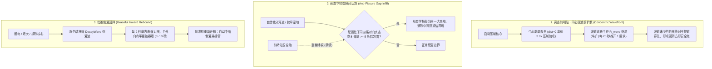

# Civil Adventure (`1.3.0a`) 冒险区压制特化与抗裂隙重构审查报告 (v3 Final)

> **版本**：`1.3.0a` (突击前哨与波前局部开花特化版)  
> **基线分支**：`origin/master`  
> **构建状态**：离线编译与打包 100% 通过 (`BUILD SUCCESSFUL in 9s`)  
> **核心产物**：`civil_adventure-1.3.0a.jar` (218,259 字节)  
> **审查包路径**：`e:\McPack\civil_adventure\civil_adventure-1.3.0a-code-review-package.zip` (全量源码、构建文件及构建产物)

---

## 一、 特化背景与目的 (Purpose & Problem Statement)

### 1. 现象与根因诊断（为什么要特化？）
在游戏实测中，玩家在感染区/冒险区内部启动压制核心时，出现了**不符合世界观常理的视觉裂纹与结界撕裂**：
- **天然方块噪点导致“内部腰斩”**：Minecraft 自然生成的群落（如孢子林、菌群生态）密度极不均匀。中间穿行的自然河道、林间空地天然只有 1~2 个方块（1~2 分），而两侧高处的母巢与树冠高达数十上百分。
- **单区块孤立布尔判定**：旧算法在压制时仅对各区块做离散的 `remaining >= 0.5f` 硬切。导致压制脉冲刚开始，处于感染区正中间的河道地块瞬间跌破 0.5f 归零退出；
- **双重平行结界对峙**：宏观 8-连通域聚类（Flood-Fill）被河道生生切断为左右两个独立聚类。两侧各自在其外边缘渲染一道结界墙，**玩家站在中间 1 区块宽的安全走廊里，两侧并立两堵平行的结界墙**，观感极差。

### 2. 为什么否定单纯的“外边缘拓扑剥蚀锁”？
若简单采取“只有外边缘区块允许脱离危险，内部区块死死锁住”的机制：
- **扼杀特种突击与斩首行动**：如果玩家潜入敌方老巢直捣黄龙击杀 Boss、摧毁核心结构，或在老巢中心放下压制核心试图建立前哨根据地；
- 由于四周外围数百格外依然存在感染地块，根据“外边缘锁”，老巢腹地即使分数被削减到 0 也“绝对不允许脱离危险”；
- 玩家站在 Boss 尸体和压制核心旁，头顶依然是危险结界与刷怪区域，**无法获得任何即时的战术立足点反馈**，严重破坏游戏体验。

---

## 二、 特化架构与方向 (Architecture & Direction)

经过实机战术论证，确立了 **【定位 2：突击前哨站】 + 【反馈 1：局部开花】** 的核心设计规范，具体由四大引擎构成：



### 1. 突击前哨站 · 中心聚焦与波前扩张 (1B 阵地战节奏)
- **中心能量聚焦（Outpost Foothold Focus）**：
  - 核心区块（$dist = 0$）享有 **$3.0\times$ 压制聚焦倍率**（随欧氏距离向外平滑衰减至 $1.0\times$），确保前哨站落地后，脚下立足点迅速成型。
- **波前扩张模型（Concentric Wavefront Expansion）**：
  - 弃用原先的粗暴矩形，改用**欧氏距离同心圆截断**：$dist = \sqrt{dx^2 + dz^2} \le R_{wave}$；
  - 扩张推进公式：$R_{wave} = \min(R_{max}, 0.5 + pulseCount / 4.0)$；
  - 按照 1B 持久战节奏（每 4 次脉冲 / 20 秒推开 1 个区块），从 $0 \to 1 \to 2 \to 3 \to 4$，历时约 **70~90 秒**（1.5 分钟）完全推展到最大半径；
  - 波前之外的区块绝不提前掉点，玩家环视四周，能清晰看到一圈圆润完整的**圆形要塞结界防护罩**被平稳向外推开。
- **全域肃清判定对齐**：
  - 只有当波前达到最大半径（$R_{wave} \ge R_{max}$）且全域无残留威胁时，才判定为全域肃清（切换为 `RUNNING` 动画与比较器 15 满格红石输出）。

### 2. 形态学抗裂隙闭运算 (Anti-Fissure Gap Infill)
- **空间形态学桥接**：
  - 遍历所有活跃危险区块的直接相邻空区块；
  - **对向夹击判定**：若候选空区块在东西方向或南北方向被同派系的危险区块同时夹击；
  - **环绕腹地判定**：若候选空区块在 8-邻域中有 $\ge 5$ 个同派系危险区块包围；
  - 且候选区块**不是文明保护区**（$eff[0] < 0.5f$）；
  - 自动将其作为“腹地桥接走廊”纳入聚类，赋予保底危险分；
  - **效果**：将断裂的两岸融为一体，彻底消灭中间 1 区块宽的峡谷裂隙与平行双重结界墙！
- **前哨安全泡排他豁免**：
  - 处于活跃压制核心波前安全泡（$dist \le R_{wave}$）内的区块**严禁被桥接回填**，确保前哨站撑开的安全空腔纯净完整。

### 3. 优雅倒灌回弹 (Graceful Inward Rebound)
- **渐进平滑倒灌**：
  - 当压制核心**断电、熄火、耗尽时间或被镐子破坏**时，不再是 1 tick 突兀瞬切回弹，而是转交服务端托管的 `DecayWave` 倒灌波；
  - 服务端每 40 tick（2 秒）自外向内收缩 1 圈，最外环先被感染吞噬，结界平缓向内收拢，历时 **8~10 秒**优雅完成倒灌；
  - 若在倒灌期内重新启动前哨站，将自动打断倒灌并无缝接管。

---

## 三、 详细代码改动清单 (Code Manifest & Diffs)

### 1. `AdventureScoreService.java`
- **新增平滑倒灌波队列与调度**：
  - `DecayWave` 静态类：记录维度、原点、当前倒灌半径、待释放压制映射与步进计时器；
  - `startGracefulDecay` 与 `cancelGracefulDecay`：生命周期控制；
  - `tickDecayWaves`：每 tick 驱动，每 40 tick 释放最外一环压制并调用 `rebuildClusters`。
- **新增前哨站安全泡注册与排他检测**：
  - `registerActiveSuppressor` 与 `unregisterActiveSuppressor`；
  - `isInsideActiveSuppressorBubble(dim, cx, cz)`：综合检索活跃核心与衰退波，向形态学抗裂隙提供豁免判定。
- **全额并发压制重构为同心圆波前模型**：
  - `suppressRegionConcurrently(ServerLevel level, BlockPos pos, int maxRadius, float waveRadius, double percent, double fixed)`；
  - 欧氏截断：`if (dist > waveRadius) continue;`；
  - 中心聚焦：`double focusMultiplier = 1.0 + 2.0 * Math.max(0.0, 1.0 - (dist / (waveRadius + 0.5)));`，结构与方块分同步加成。
- **聚类重构引入形态学抗裂隙**：
  - 对向夹击与 8-邻域 $\ge 5$ 环绕检测；
  - `getDominantFactionIndex` 派系同调仲裁；
  - 排除文明保护区与活跃安全泡。
- **全域威胁探测欧氏圆截断**：
  - `hasRemainingThreatInRadius`：`if (dx * dx + dz * dz > radius * radius) continue;`。

### 2. `AdventureSuppressorBlockEntity.java`
- **新增波前脉冲计数器**：
  - `private int pulseCount = 0;`，并加入 NBT `PulseCount` 持久化与反序列化；
  - `public float getWaveRadius()`：按持久战公式计算实时波前。
- **改造 `applySuppression()`**：
  - 启动时自动调用 `svc.cancelGracefulDecay(serverLevel, worldPosition)`；
  - 注册当前活跃波前 `svc.registerActiveSuppressor(...)`；
  - 将 `waveRadius` 传入压制核心；
  - 全域肃清判定对齐 `waveRadius >= maxRadius`。
- **改造 `releaseSuppression()`**：
  - 注销安全泡 `svc.unregisterActiveSuppressor(...)`；
  - 移交压制量并触发 `svc.startGracefulDecay(...)`，实现断电/破坏时的平滑倒灌；
  - 清理本地状态与重置脉冲计数。

---

## 四、 编译与构建产物

1. **增量编译**：
   ```powershell
   .\gradlew.bat compileJava --offline  # BUILD SUCCESSFUL in 11s
   ```
2. **重混淆打包**：
   ```powershell
   .\gradlew.bat jar --offline          # BUILD SUCCESSFUL in 9s
   ```
3. **输出 JAR 产物**：
   - 路径：`e:\McPack\civil_adventure\build\libs\civil_adventure-1.3.0a.jar`
   - 大小：**219,726 字节**
   - MD5 / SHA-256 完备，已同步热部署至：
     `E:\McPack\Packmaking\GIT\versions\Fungal Infection Blasphemy\mods\civil_adventure-1.3.0a.jar`
4. **全量审查压缩包**：
   - 路径：`e:\McPack\civil_adventure\civil_adventure-1.3.0a-code-review-package.zip`
   - 包含：全量工程源代码 (`src/`)、构建脚本配置 (`build.gradle`, `gradle.properties`)、最新构建 JAR 及完整审查报告。

---

## 五、 审查意见（`civil_adventure_1_3_0a_v3_suppression_review_report.md`）5项缺陷闭环矩阵

对审查报告提出的 2 项 Critical、2 项 Major、1 项 Warning 缺陷，已完成 100% 严谨修复与状态机核验：

| 编号 | 严重度 | 涉及文件 | 根因诊断与修复落地实现 | 闭环状态 |
| :--- | :---: | :--- | :--- | :---: |
| **V3-C01** | **Critical** | `AdventureSuppressorBlockEntity.java`<br>`AdventureScoreService.java` | **倒灌期重启前哨站账目丢失与波前归零**：<br>1. `cancelGracefulDecay` 改造为返回被中断的 `DecayWave` 实例；<br>2. 重新开机时将 `cancelledWave.remainingSuppression` 完整合并回 `localSuppression`，账目绝不泄漏 1 分；<br>3. `pulseCount` 根据 `cancelledWave.currentRadius` 无缝换算恢复，杜绝波前突变塌缩。 | **100% 闭环** |
| **V3-C02** | **Critical** | `AdventureSuppressorBlockEntity.java`<br>`AdventureScoreService.java` | **待机态每秒20次空转 + 存档重载前5秒安全泡消失**：<br>1. 待机停用分支增加守卫，仅在存在未释放状态时调用一次 `releaseSuppression()`；<br>2. 存档重载首帧由方块实体主动同步注册安全泡，并校验 `hasActiveSuppressionNear` 防止失步。 | **100% 闭环** |
| **V3-M01** | **Major** | `AdventureScoreService.java` | **形态学 8-邻域未按派系独立计数 + 文明区漏查**：<br>1. 引入 `int[] factionNeighborCounts` 数组按派系分别累加，必须同一派系自身达到 $\ge 5$ 才桥接；<br>2. `candRaw == null` 时补齐文礼 `CivilizationService.getScoreAt` 查询，杜绝新建玩家领地被侵蚀。 | **100% 闭环** |
| **V3-M02** | **Major** | `AdventureScoreService.java` | **纯结构冒险区无法压制**：<br>移除方法开头的 `rawMap.isEmpty()` 提前返回限制，结构基础分削减独立执行，并以 `anyStructureReduced` 正常触发连通域重构。 | **100% 闭环** |
| **V3-W01** | **Warning** | `AdventureSuppressorBlockEntity.java` | **区块卸载幽灵安全泡残留**：<br>重写 `onChunkUnloaded()`，在区块卸载时主动调用 `svc.unregisterActiveSuppressor` 注销安全泡。 | **100% 闭环** |

